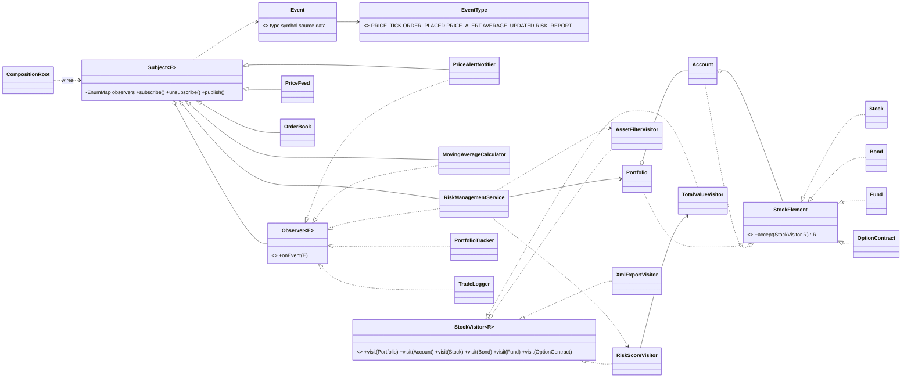

# Stock Exchange: Observer + Visitor (Assignment 6, Variant 3)

Java 17 + JUnit 5, nothing else. A live market (price feed, order book) notifies listeners through
my own generic `Subject` / `Observer` (lecture 8). A stable portfolio tree
(Portfolio -> Account -> stocks, bonds, funds, options) gets new operations through a generic
`StockVisitor<R>` (lecture 9). A price alert triggers visitors on the affected accounts only, and the
result returns to the system as a new event. Producers run on an `ExecutorService`.
No `java.util.Observable`, no event-bus library.

## Run

```
mvn test
```
IntelliJ: run `com.stockexchange.CompositionRoot.main` (arguments: producer threads, events per producer).

## Structure

```
src/main/java/com/stockexchange/
  observer/   Event, EventType, Observer, Subject
  visitor/    StockElement, StockVisitor
    composite/  Portfolio (level 1), Account (level 2)
    leaf/       Stock, Bond, Fund, OptionContract
    visitors/   TotalValueVisitor, RiskScoreVisitor, AssetFilterVisitor, XmlExportVisitor
  domain/     PriceFeed, OrderBook (sources); PriceAlertNotifier, PortfolioTracker,
              MovingAverageCalculator, TradeLogger, RiskManagementService (listeners)
  CompositionRoot.java
src/test/java/com/stockexchange/
  observer/SubjectObserverTest, visitor/StockVisitorTest,
  integration/IntegrationTest, concurrency/StressTest
```

## Observer side

* **Sources (2):** `PriceFeed` (PRICE_TICK) and `OrderBook` (ORDER_PLACED).
* **Listeners (5):** `PriceAlertNotifier`, `PortfolioTracker`, `MovingAverageCalculator`, `TradeLogger`,
  `RiskManagementService`.
* **Chain:** `MovingAverageCalculator` is an observer of PRICE_TICK and a subject of AVERAGE_UPDATED
  (which `PortfolioTracker` consumes). `PriceAlertNotifier` and `RiskManagementService` are chain links too:
  tick -> alert -> risk report -> log.
* **Per-type subscription:** `subject.subscribe(EventType, observer)`; a listener may subscribe to several
  types or to several subjects (`TradeLogger` listens to orders, alerts and risk reports).
* **Push model, justified:** an `Event` is an immutable record that carries all its numbers (the data map is
  copied defensively). With pull, a listener would call back into a source that other threads are changing and
  could read a newer or half-updated state than the event describes. Push gives every listener a consistent
  snapshot, needs no lock on the source and keeps listeners independent of the source class.
* **Join and leave at runtime:** `Subject` holds one `CopyOnWriteArrayList` per `EventType`. The `EnumMap` is
  filled in the constructor and never changed again, so there is no lazy initialization and no global lock.
  `publish` iterates a snapshot, so a listener can subscribe or unsubscribe inside its own handler or from
  another thread without errors; the change applies from the next event.
* **Failure isolation:** a throwing listener is logged; the others still receive the event.
* **Ordering:** listeners run in subscription order. `CompositionRoot` subscribes `PortfolioTracker` first on
  ticks so the price is stored before an alert is inspected. This is an implementation property, not a promise
  of the pattern.

## Visitor side

* **Tree:** `Portfolio` (container) -> `Account` (container) -> `Stock`, `Bond`, `Fund`, `OptionContract`.
  3 levels, 2 container types, 4 leaf types. Elements are immutable records: data plus the one-line `accept`.
* **Double dispatch:** `element.accept(visitor)` is a virtual call, so the element's runtime class is chosen
  (first dispatch); inside, `visitor.visit(this)` is overload-resolved at compile time against the static type
  `this`, so `visit(Stock)` is picked (second dispatch). A client cannot just call `visitor.visit(node)` on a
  `StockElement` variable: the compiler sees only the interface and there is no `visit(StockElement)`.
  (`doubleDispatchPicksTheVisitMethodOfTheRuntimeClass` demonstrates it.)
* **Who traverses: the visitor.** A visitor returns `R`, and only the visitor knows how child results combine
  (sum, weighted average, list concatenation, XML nesting). A tree-driven traversal could not combine arbitrary
  `R` or skip subtrees. Cost: each visitor repeats a one-line loop over children.
* **Visitors:** `TotalValueVisitor` (numeric, stateless; option = intrinsic value x 100 per contract);
  `RiskScoreVisitor` (accumulates weighted risk, total value and leaf count across the whole tree in its own
  fields; a container returns the score of its own subtree only; use a new instance per run);
  `AssetFilterVisitor` (returns the leaves matching a predicate); `XmlExportVisitor` (hand-written, nested,
  with escaping).

## Integration

`PriceFeed.tick` -> `PriceAlertNotifier` publishes PRICE_ALERT -> `RiskManagementService` runs
`AssetFilterVisitor.bySymbol` on each account and, for accounts holding the symbol, `RiskScoreVisitor` and
`TotalValueVisitor` on **that account only** -> publishes RISK_REPORT -> `TradeLogger` records it.

## Concurrency

* `CompositionRoot.runProducers` starts N producer threads (configurable) on a fixed `ExecutorService`;
  events are delivered synchronously, so when it returns nothing is in flight and nothing is lost.
* No lock on the whole subject: copy-on-write lists; `ConcurrentHashMap` and `LongAdder` in
  `PortfolioTracker` / `TradeLogger`; one small lock per symbol window in `MovingAverageCalculator`
  (publishing happens after the lock is released); `AtomicBoolean` per alert rule.
* Graceful shutdown: `shutdown()`, wait up to 10 s, `shutdownNow()` only on timeout. A producer failure
  is rethrown from `runProducers`. A test checks that no `producer-*` thread is alive afterwards.

## Clean Code (ch. 11-12)

`CompositionRoot` is the only place that creates and wires collaborators; all classes get dependencies by
constructor; no lazy initialization in business code; valuation logic exists once (the risk visitor reuses
`TotalValueVisitor`); `TotalValueVisitor` takes a price-lookup function, so visitors do not depend on `domain`.

## UML



## Trade-off proof (two separate commits)

The baseline is this project. The two changes are stored as patches in `docs/patches/`; apply each with
`git apply docs/patches/<file>` and commit it on its own.

**Commit 1: new visitor, no element class touched** (`trade-off-1-new-visitor.patch`)

| File | Change |
| --- | --- |
| `visitor/visitors/AssetAllocationVisitor.java` | new |
| `test/.../visitor/AssetAllocationVisitorTest.java` | new |

Existing files changed: **0**; element classes changed: **0**. Cost: one class implementing all 6 visit methods.

**Commit 2: new element `CryptoAsset`** (`trade-off-2-new-element.patch`)

| File | Change |
| --- | --- |
| `visitor/leaf/CryptoAsset.java` | new element |
| `visitor/StockVisitor.java` | + `visit(CryptoAsset)` |
| `visitor/visitors/TotalValueVisitor.java` | + `visit(CryptoAsset)` |
| `visitor/visitors/RiskScoreVisitor.java` | + `visit(CryptoAsset)` |
| `visitor/visitors/AssetFilterVisitor.java` | + `visit(CryptoAsset)` |
| `visitor/visitors/XmlExportVisitor.java` | + `visit(CryptoAsset)` |
| `visitor/visitors/AssetAllocationVisitor.java` | + `visit(CryptoAsset)` |
| `test/.../visitor/StockVisitorTest.java` | anonymous visitor must implement the new method |
| `test/.../visitor/CryptoAssetTest.java` | new |

Existing files changed: **7** (the visitor interface, 5 visitors and a test visitor). The compiler forces every
one of them; the cost is V + 1 edits per new element for V visitors.

**When I would reject Visitor:** when element types change often and operations are few. Then a plain virtual
method per element touches only the new class. Visitor pays off when the element set is stable and operations
keep growing, as with portfolio asset classes and reports.

## Tests (33 baseline, 37 after both patches)

`SubjectObserverTest` (11): per-type delivery, unsubscribe, unsubscribe and subscribe inside a handler,
failing listener, immutable events, tracker, hand-calculated moving-average chain, alert crossings, logger.
`StockVisitorTest` (12): values, fallbacks, options, risk score (whole tree and per container), filter, XML
exact string / escaping / balance, double dispatch. `IntegrationTest` (4): alert -> inspection of the right
accounts only -> logged report. `StressTest` (6 runs): 4 x 1000 with exact counts, 1/3/8 threads, no leftover
threads, subscribe/unsubscribe churn during publishing.

Fixture (AAPL 120, MSFT 240, UST10Y 102, VOO 60): ACC-1 = 1200 + 2040 + 2000 = 5240,
ACC-2 = 1200 + 1200 = 2400, portfolio = 7640, risk = 482800 / 7640.

## Suggested commit plan (2 weeks)

1. skeleton, pom, README stub  2. `Event`, `EventType`, `Observer`, `Subject` + tests  3. sources
4. listeners (tracker, logger, alert)  5. moving-average chain  6. composite tree + `StockVisitor`
7. total value and risk visitors + tests  8. filter and XML visitors + tests  9. `RiskManagementService`
10. `CompositionRoot` + producers + stress test  11. trade-off 1 (patch 1)  12. trade-off 2 (patch 2)  13. README, UML
